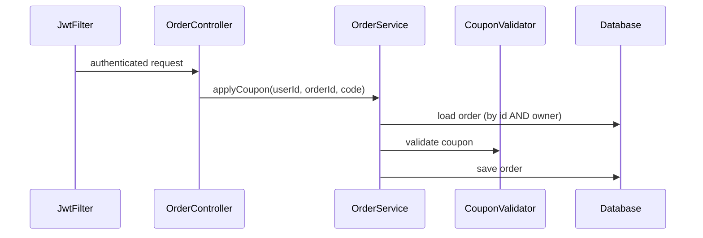

# Example session

**Feature:** apply a coupon to an order. **Codebase:** Spring Boot 3, Java 17, PostgreSQL, JUnit 5.
The hidden learning map for this session is the example at the end of `learning-map.md`.

Notes in *italics in a quote block* are Claude's hidden reasoning, not shown to the learner.

---

**Learner:** I'm new. How does applying a coupon work?

> *Explored the code silently first: `OrderController`, `ApplyCouponRequest`, `OrderService`, `CouponValidator`, `Order`, `OrderPricingResponse`, the `ApplyCoupon*Test` files, and the commit that added the feature.*

**Claude:** Before we start: will you be changing this feature soon, or do you want to understand it in general?

**Learner:** I have a ticket to add a "max uses per coupon" rule.

> *Task touches validation and saving. Move optimistic locking from held back into D4. Rate limiting stays held back.*

**Claude:** Good, then we will go deep enough for that ticket. We will go in 4 parts: the big picture, what goes in, what happens inside, what comes out. About 14 short steps, one idea each.

**Step A1 of 14: What it does** (Part A: the big picture)

At checkout, a customer can type a code like `SUMMER10` to lower the price of an order they have not paid yet. Marketing creates the codes. It was built for Black Friday campaigns (Confirmed: commit `a91f3c2`).

**Care about:** this only works on unpaid orders.

**Quick check:** a customer paid yesterday and finds a coupon today. Should they be able to apply it to that order?

**Learner:** No, it's paid.

**Claude:** Correct. A paid order is finished.

**Step A2 of 14: The one idea everything depends on**

When the coupon is applied, the backend calculates the discount once and writes it into the order, in `orders.discount_amount`. After that, the order keeps its own discount.

**Look at:** `Order.java:88`, the `applyDiscount` method. Just notice that it sets a field.
**Care about:** the discount is stored, not calculated again each time.
**Keep this in mind:** "the order remembers its price". You will need it in B3, D1, and for your ticket.

**Quick check:** marketing changes `SUMMER10` from 10% to 20% tomorrow. What happens to an order that used it today?

**Learner:** It becomes 20%?

> *Wrong on the core idea. Do not move on. New angle: an analogy, then a smaller check.*

**Claude:** Not quite, and it is a very common first guess. Think of a receipt: once the shop prints it, a price change the next day does not change your receipt. `discount_amount` is that receipt. Nothing reads the coupon's percentage again after it is applied.

**Quick check:** the order was 120.00 with 10% off. After marketing's change, what is its `discount_amount`?

**Learner:** Still 12.00.

**Claude:** Correct.

**Step B1 of 14: The endpoint** (Part B: what goes in)

```
PUT /api/v1/orders/{orderId}/coupon
```
Only a logged-in customer can call it.

**Look at:** `OrderController.java:41`.
**Care about:** the order id is in the URL, not in the body. The customer's id comes from the login token, never from the request.
**Keep this in mind:** "orderId comes from the URL, anyone can change it". You will need it in C2.

**Quick check:** where does the backend get *who* is calling: the URL, the body, or the token?

**Learner:** Token.

**Claude:** Correct.

**Step B2 of 14: The request DTO**

This is the whole request body:
```json
{ "couponCode": "SUMMER10" }
```

| Field | Type | Required | Validation | Goes to |
|---|---|---|---|---|
| couponCode | string | yes | not blank, max 32 chars, letters/digits/`-`/`_` | trimmed + uppercased, then matched against `coupons.code` |

**Look at:** `ApplyCouponRequest.java`, the 3 annotations on the field.
**Care about:** a bad format is rejected with 400 before the database is touched.
**Skip for now:** the response DTO. It comes in Part D.
**Keep this in mind:** `" summer10 "` becomes `"SUMMER10"`. You will see where in C4.

**Quick check:** a customer sends `"couponCode": "SUMMER 10!"`. Does the database get queried, and what status do they get?

**Learner:** No query, 400.

**Claude:** Correct. The space and `!` fail the pattern.

**Step B3 of 14: What is missing from the request**

Look at the JSON again. There is no `discount` and no `total`.

**Care about:** the client never sends a price.
**Remember A2:** the server calculates the discount and stores it on the order.

**Quick check:** a teammate suggests adding `discountAmount` to the request "so the frontend can send it". What could a customer do if we accepted it?

**Learner:** Hmm, faster?

> *Missed the security point. Narrowing hint, not the answer.*

**Claude:** Think from the customer's side. You can edit that JSON in your browser. You send `"discountAmount": 120.00` on a 120.00 order. What would you pay?

**Learner:** Zero. So they set their own price.

**Claude:** Correct. That is why the field is missing on purpose, and why the server ignores it if someone sends it (Confirmed: `ApplyCouponSecurityTest`).

**Recap of Part B:** URL gives `orderId` · token gives who is calling · body gives `couponCode` (validated, then normalized) · the client never sends a price.

Ready for Part C, where we follow the request inside?

**Learner:** Yes.

**Claude:**
**Step C1 of 14: The path** (Part C: what happens inside)



**Care about:** the cheap checks run first (token, format), the database work runs later.
**Skip for now:** the exact lines. Each box gets its own step.

**Quick check:** a request has a bad token and a bad coupon format. Which error does the customer see?

**Learner:** 401, the filter is first.

**Claude:** Correct.

**Step C2 of 14: The order must be yours**

**Look at:** `OrderService.java:47`: `findByPublicIdAndCustomerId(orderId, user.id())`.
**Remember B1:** anyone can change the `orderId` in the URL.
**Care about:** the order is loaded by id AND owner. Someone else's order looks exactly like a missing order: both give the same 404 (Confirmed: test `should_return_identical_404_for_missing_and_foreign_order`).

**Quick check:** why not return 403 "not your order" instead of 404?

> *... the lesson continues through C3-C5 and D1-D3 in the same way ...*

---

**Step D1 of 14: The money in the response** (Part D: what comes out)

```json
{ "orderId": "ord_8f2a", "subtotal": 120.00, "discountAmount": 12.00, "total": 108.00, "currency": "USD", "appliedCoupon": { "code": "SUMMER10", "type": "PERCENTAGE", "value": 10, "description": "10% off summer sale" } }
```
This step covers the 3 money fields only.

| Field | Comes from | Meaning |
|---|---|---|
| subtotal | `orders.subtotal` | Price before discount, so the UI can show it crossed out |
| discountAmount | `orders.discount_amount` | Money taken off. Stored (remember A2) |
| total | derived: `subtotal - discountAmount` (120.00 - 12.00 = 108.00) | What the customer pays, never below 0 |

**Skip for now:** `appliedCoupon` and its 4 fields. That is the next step.

**Quick check:** which of these 3 fields is not a database column?

**Learner:** total.

**Claude:** Correct. It is calculated every time the response is built.

> *Learner answered the last 4 checks fast and right. Offer to speed up.*

You are moving fast. Want me to cover `appliedCoupon` and the errors together in one step, then go to your ticket?

> *... D2-D3 merged ...*

---

**Step D4 of 14: Your ticket: max uses per coupon**

**Remember C4:** all coupon rules live in `CouponValidator.validate` (`CouponValidator.java:15`). Your rule goes there.
**Remember D3:** a used-up coupon should return the same `COUPON_INVALID`, not a new specific message, so codes cannot be probed.
**Remember C5:** two customers can apply the last use at the same moment. The count check and the save must be protected, or both succeed. Ask your team whether to use the existing optimistic lock on the coupon row or a database constraint.
**Remember A2:** do not touch old orders. Their discount is stored.

**Quick check:** a coupon has 1 use left. Two customers press "apply" at the same second. Without protection on the save, how many orders get the discount?

---

**Final recap** (after the last check)

Applying a coupon locks a discount into an unpaid order. The request carries only the code; the order id comes from the URL and the customer from the token. The service checks ownership, status, then the coupon rules, calculates the discount, and saves it in one transaction. The response shows stored money fields and a derived total. Errors are deliberately vague so attackers learn nothing. Your max-uses rule goes in `CouponValidator`, returns `COUPON_INVALID`, and must be safe when two saves race.

**Open questions for the team:** what should happen when a coupon expires between apply and payment? (Unknown in code and tests.)

Want me to save a short recap file you can keep?
